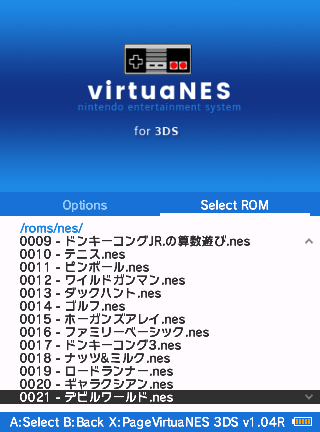
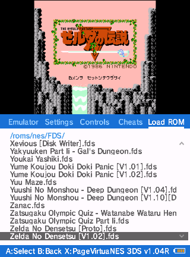
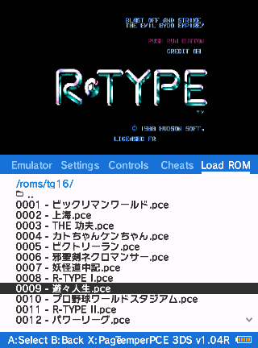
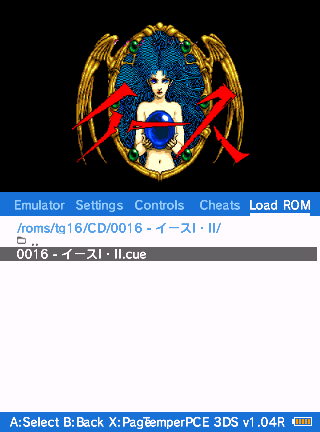
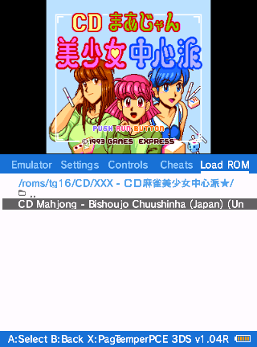
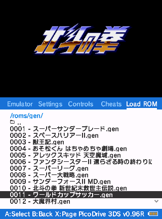

# Emus for 3DS 
ここは、R-YaTianさんが作成してくれた「Emus for 3DS」を自分用にカスタマイズする場所です。

## 現在対応したこと
* ゲーム選択画面を日本語ファイルでも表示出来るようにした
* 中華表示を消して、Englishのみの表示にした
* (PicoDrive)
  - ＣＤゲームを動くようにした。
  - ＣＤゲーム動かしてから、次のゲームへ選べるようにした。
* (TemperPCE)
  - ＣＤゲームはもともと動いてた
  

## 今後、対応したいこと
* (PicoDrive)
  - ＣＤゲームを動かしてるときに、スクリーンショット撮れるようにしたい。

  
## Biosに関して
* Biosを入れる場所を変更した
  - (VirtuaNES) /3ds/virtuanes_3ds/bios
  - (TemperPCE) /3ds/temperpce_3ds/syscards
  - (PicoDrive) /3ds/picodrive_3ds/bios

## Screenshots
## VirtuaNES core

<table>
  <tr>
    <td width="50%" align="center"></td>
    <td width="50%" align="center"></td>
  </tr>
  <tr>
    <td valign="top" width="50%" align="center">日本語ファイル名 画面</td>
    <td valign="top" width="50%" align="center">ディスク システム 画面</td>
  </tr>
  <tr><td colspan="2"></td></tr>
 </table>
  
    
## TemperPCE (TurboGrafx / PC-Engine) core

<table>
  <tr>
    <td width="33%" align="center"></td>
    <td width="33%" align="center"></td>
    <td width="33%" align="center"></td>
  </tr>
  <tr>
    <td valign="top" width="33%" align="center">日本語ファイル名 画面</td>
    <td valign="top" width="33%" align="center">ＣＤゲーム 画面</td>
    <td valign="top" width="33%" align="center">GAMES EXPRESSゲーム 画面</td>
  </tr>
  <tr><td colspan="2"></td></tr>
 </table>
  

## PicoDrive (Sega Master System / Mega Drive) core

<table>
  <tr>
    <td width="50%" align="center"></td>
  </tr>
  <tr>
    <td valign="top" width="50%" align="center">日本語ファイル名 画面</td>
  </tr>
  <tr><td colspan="2"></td></tr>
 </table>
  

### Credits
- [bubble2k16](https://github.com/bubble2k16): Original author of original English version
- R-YaTian, [Emus for 3DS](https://github.com/R-YaTian), for creating the excellent base this fork builds on
